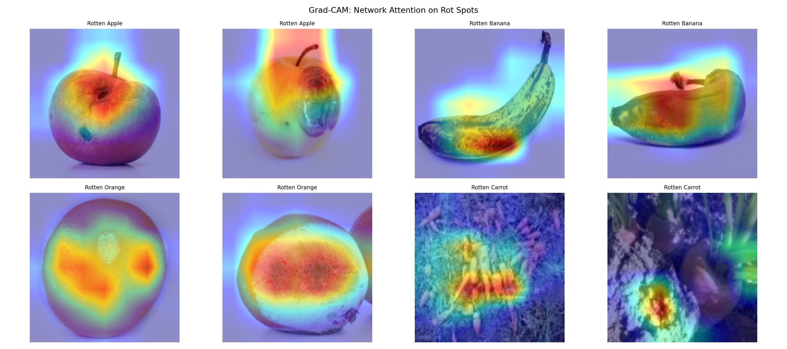

# FreshGuard · AI quality control for fresh produce

**Point a phone camera at a piece of fruit or veg. FreshGuard says Fresh, Sell soon or
Reject, shows where it saw the damage, and turns that into a markdown price, a reorder
suggestion and the euros saved by not throwing it away.**

Deep Learning final project, IE University, Team FreshGuard. ·
[Glossary](#glossary) · [Technical reference](docs/TECHNICAL.md) ·
[Slide deck](FreshGuard_Deck.html)



---

## The problem in 30 seconds

Supermarkets throw away roughly **4 to 6% of what they sell in fruit and veg**, and much of
it is avoidable. The problem is timing: decay is spotted too late, by a busy employee
checking the shelf once or twice a day. A day earlier, the same tomato could have been
marked down 20% and sold.

There is also a legal push. Spain's **Law 1/2025** on food waste requires shops to act on
food near the end of its life (discount it or donate it) instead of binning it. But **loose
produce has no expiry date**. A yogurt has one; a single apple does not. For loose fruit,
**how it looks is the only signal** of how close it is to spoiling.

That is a computer-vision problem: read freshness from a photo, consistently, all day.

## What it does

| Step | What happens | Example |
|---|---|---|
| 1. Find | Spots the item in the camera view | "That's a banana" |
| 2. Grade | Decides how fresh it is | 🟢 Fresh · 🟡 Sell soon (mark down 20 or 40%) · 🔴 Reject (donate if edible) |
| 3. Abstain | If it is not sure, it says so and asks a person | ⚪ Needs review, added to a review queue |
| 4. Explain | Highlights the spot it reacted to | A heatmap over the brown patch |
| 5. Value | Counts the money saved by marking down instead of binning | "EUR 0.15 recovered" |
| 6. Forecast | Predicts next week's spoilage and suggests how much to reorder | "Order about 12% less, lighter week ahead" |

It runs as a web app on a laptop, and staff can use it from a phone.

---

## Results

The model was tested on **4,140 photos it never saw during training**, across 20 classes
(10 kinds of produce, each fresh or rotten).

| Question | Answer | In plain words |
|---|---|---|
| How often is the grade right? | **95.8%** | 24 out of 25 photos get the exact fruit and condition right |
| Fresh or rotten, can it tell? | **AUC 0.996** | Almost perfect at the decision that matters most for the shop |
| Why this model and not a simpler one? | **31.9% → 75.0% → 95.8%** | A basic network, a small image model built from scratch, then a pre-trained one we adapted. Adapting a pre-trained model wins by far |
| Where does it struggle? | Rotten bell peppers, **73%** | Peppers wrinkle rather than change colour, so rot is harder to see |
| Could a newer model do better? | A Vision Transformer reaches **98.4%** | Better, and fixes the peppers, but needs about 3.5x the computing per photo. A trade-off we measured, not assumed |

**What this is not, said plainly:**

- The photos come from a clean public dataset. A real shop's lighting and cameras will
  lower accuracy until the model sees a small set of local photos; the review queue is
  built to collect exactly those.
- The two years of sales history behind the forecast are **simulated** (with Spanish
  seasons). The method is real; the data is a stand-in.
- The euro figures in projections are **illustrative**, not measured savings.

---

## The business case

- **Where the money comes from:** every "Sell soon" item caught a day early is sold at a
  discount instead of thrown away. The app counts only those items, and only about 60% of
  their price, so the figure is conservative.
- **Why now:** Law 1/2025 turns food-waste reduction from nice-to-have into a legal duty,
  and loose produce is exactly where shops have no tool.
- **Why it can work:** it runs on hardware shops already own (a phone or a cheap webcam),
  it explains every decision, and it improves as staff correct it.
- **What a real rollout still needs:** a quick per-store check, a small GPU box for fast
  conveyor belts, and a link to the till so markdowns apply automatically.

---

## Try it

```bash
pip install -r requirements.txt          # Python 3.12 recommended
uvicorn main:app --app-dir backend --host 0.0.0.0 --port 8000
# open http://localhost:8000
```

To use a phone as the camera (phones need HTTPS), run
`powershell -ExecutionPolicy Bypass -File scripts\go_live.ps1` and scan the QR code the app
shows. Details in the [technical reference](docs/TECHNICAL.md#11-run-it-on-your-phone-the-demo-rig).

**The app's tabs:** Live scan (camera and verdicts) · Manager (forecast, money saved,
reorder plan, Law 1/2025 actions) · Market (wholesale prices) · Review (items the model was
unsure about) · Model (all the evidence) · Lab (try the models yourself).

---

## Team

**Marco Ortiz Togashi** (@ma731): project coordinator; backend and frontend integration,
the repository and the demo rig. **Yaxin Wu:** core model (comparison, training,
fine-tuning). **BigBossBass:** evaluation and explainability. **Jorge Vildoso:** the
spoilage forecast. **Batão:** data and preprocessing.

---

## Glossary

| Term | Meaning |
|---|---|
| **ANN** | A basic neural network. Our deliberately weak starting point (31.9%) |
| **CNN** | A neural network built for images: it looks for edges, colours and textures |
| **Transfer learning** | Starting from a model already trained on millions of photos and adapting it to produce |
| **MobileNetV2** | The pre-trained image model we adapted. Small and fast enough for a phone or laptop |
| **YOLO** | A ready-made model that finds objects in a camera frame. We use it to locate the fruit |
| **Vision Transformer (ViT)** | A newer image model type. More accurate here, but heavier to run |
| **RNN / LSTM** | Networks for sequences over time. Ours forecasts next week's spoilage |
| **Grad-CAM** | A heatmap showing which part of the photo drove the decision |
| **Abstain** | The model says "not sure" and hands the item to a person instead of guessing |
| **Active learning** | Using those "not sure" items, once a person labels them, to improve the model |
| **Accuracy** | The share of photos graded exactly right |
| **AUC** | How well the model separates fresh from rotten, from 0.5 (coin flip) to 1.0 (perfect) |
| **Recall** | Of all the truly rotten peppers, the share the model caught |
| **Domain shift** | Accuracy drops when real photos look different from training photos |
| **Shrink** | Retail term for stock lost to waste, damage or theft |

---

## Going deeper

The **[technical reference](docs/TECHNICAL.md)** has everything else: the architecture
diagram, all three models with real code, the data pipeline, the Vision Transformer
comparison, detection and tracking, how a probability becomes a price, robustness tricks,
Grad-CAM, the review loop, the LSTM forecast, every app tab, the API, training from
scratch, tests and drift monitoring, limitations and the roadmap.
